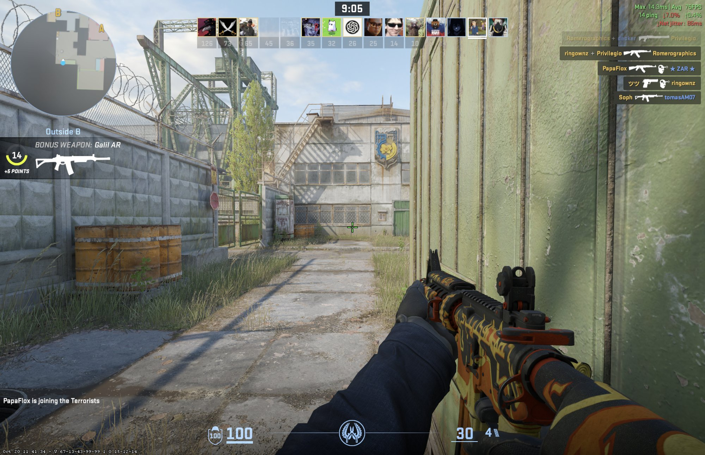
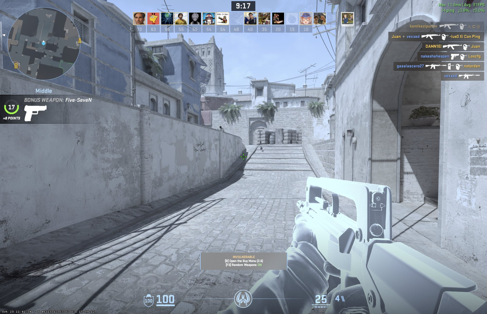

# JitterBreak for macOS

**The anti-lag utility for macOS gamers living in the menu bar. Fixes Wi-Fi ping spikes and jitter caused by Apple's AWDL (AirDrop/Handoff) and LLW (Low-latency WLAN) background scanning.**

[](https://go.dev/)
[](https://swift.org/)
[](#)

## The Problem: Why does macOS lag on Wi-Fi?

If you game on a Mac using Wi-Fi either locally or via streaming services such as Moonlight, you have likely experienced random ping spikes every few seconds.

This happens because macOS periodically forces your Wi-Fi card to switch channels to scan for nearby Apple devices using the **Apple Wireless Direct Link (AWDL)** protocol. This scanning process interrupts your connection to your router, causing massive latency spikes (jitter).

**Common (but flawed) workarounds:**

- _Turning off Bluetooth:_ Partially stops the scanning but disables your wireless headphones, mice, and Apple Watch unlock.
- _Turning off AirDrop/Location:_ Often insufficient, as the `sharingd` background daemon will aggressively attempt to turn the interfaces back on.
- _Turning on Game Mode:_ Doesn't stop the scanning. Even with Game Mode forced on, CS2 still reports packet loss and jitter without JitterBreak:

  ```bash
  gamepolicyctl game-mode set on     # Forces macOS Game Mode on (needs Xcode installed)
  gamepolicyctl game-mode set auto   # Back to the default
  ```

  

## The Solution: JitterBreak

JitterBreak is a native tool that eliminates ping spikes while allowing you to keep your Bluetooth devices connected.

It works by:

1. Sending a `SIGSTOP` signal to the `sharingd` daemon, freezing it in RAM so it cannot auto-restart the network interfaces.
2. Bringing down the `awdl0` and `llw0` virtual network interfaces using `ifconfig`.
3. Restoring everything cleanly back to normal once you finish your gaming session.

With JitterBreak on, CS2 shows 0.8% packet loss and no jitter warning:



## Architecture

JitterBreak is built using a two-tier architecture:

- **The Core (`jitterbreak-core`):** A backend engine written in **Go**. It handles privilege escalation (`sudo`), OS signals, and network interface manipulation safely. It can be run as a standalone CLI tool.
- **The GUI (`JitterBreak.app`):** A native macOS menu bar app written in **Swift / SwiftUI**. It wraps the Go binary so you can toggle JitterBreak with one click, without using the terminal.

## Installation

### Option A: Menu Bar App (GUI)

The easiest way to install the JitterBreak GUI is via Homebrew:

```bash
brew install --cask davidrlopez/tap/jitterbreak-app
```

**Manual Installation:**

1. Download the latest `JitterBreak.dmg` from the Releases tab.
2. Open the `.dmg` and drag `JitterBreak.app` to your Applications folder.
3. Launch it. It will live silently in your top Menu Bar.
4. Click "Start JitterBreak" (macOS will prompt for TouchID/Password to grant the internal Go engine root privileges).

**First launch: macOS blocks the app**

JitterBreak isn't notarized by Apple, so the first time you open it macOS says it could not verify that the app is free of malware. This happens whether you installed it with Homebrew or from the `.dmg`. To open it:

1. Open `JitterBreak.app` once and click "Done" on the warning.
2. Go to System Settings > Privacy & Security and scroll down to the Security section.
3. Next to the message saying JitterBreak was blocked, click "Open Anyway".
4. Confirm with Touch ID or your password. If macOS asks again, choose "Open Anyway".

You only have to do this once; after that the app opens normally. The source of both the app (`JitterBreak/`) and the engine that changes your network settings (`core/main.go`) is in this repository if you want to read what it does before you allow it.

If you'd rather not allow an unverified app, use the CLI (Option B). Homebrew builds it from source on your Mac, so macOS doesn't block it.

### Option B: Terminal CLI (For Power Users)

If you prefer to use the terminal without the GUI, you can install the standalone Go engine via Homebrew:

```bash
brew install davidrlopez/tap/jitterbreak
```

**CLI Usage:**

Because JitterBreak modifies network interfaces, most commands require root privileges (`sudo`).

```bash
jitterbreak --help     # Shows the help menu (no sudo required)
sudo jitterbreak       # Starts Interactive mode (Press Ctrl+C to exit)
sudo jitterbreak on    # Activates anti-lag (turns off AWDL/LLW) and exits
sudo jitterbreak off   # Deactivates anti-lag (turns on AWDL/LLW) and exits
```

**Build from source (Optional):**

```bash
git clone https://github.com/davidrlopez/JitterBreak.git
cd JitterBreak/core
go build -o jitterbreak main.go
```
